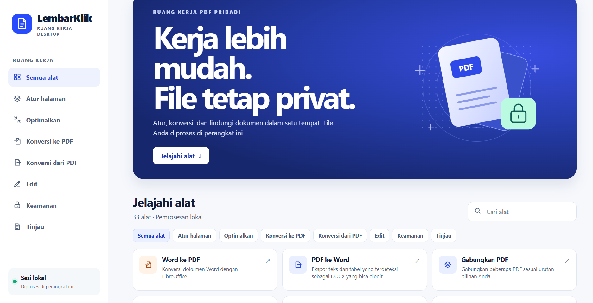

# LembarKlik 2.0

LembarKlik adalah alat PDF offline untuk Windows dengan antarmuka Bahasa Indonesia. Aplikasi terbuka di browser, dan pemrosesan dokumen berjalan di laptop melalui alamat lokal `127.0.0.1`.

## Versi desktop Windows (64-bit)

1. Unduh `LembarKlik-Windows-x64.zip` dari [GitHub Releases](https://github.com/Riiezee/lembarklik/releases) saat tersedia.
2. Klik kanan ZIP dan pilih **Ekstrak Semua** atau **Extract All**.
3. Buka folder `LembarKlik` hasil ekstrak.
4. Klik dua kali `LembarKlik.exe`.

Biarkan folder `_internal` tetap di samping `LembarKlik.exe`.



## Versi ZIP sumber di Windows

1. Ekstrak ZIP dan buka folder `LembarKlik`.
2. Jalankan `setup.bat` sekali dengan internet aktif. Setup memakai Python 3.11 atau lebih baru jika tersedia. Jika belum ada, setup mencoba memasang Python 3.13 lewat WinGet.
3. Jika muncul **Install LibreOffice now?**, pilih **Y** untuk mengaktifkan konversi Word, Excel, dan PowerPoint ke PDF. Pilih **N** jika ingin menyelesaikan setup standar.
4. Setelah muncul **Setup complete**, jalankan `run.bat`. Biarkan jendela terminal tetap terbuka. Tekan Ctrl+C di terminal untuk menghentikan aplikasi.
5. Pilih alat, masukkan file, lalu ekspor. Hasilnya tersimpan di lokasi unduhan browser.

Gabung, pisah, putar, dan kompres PDF tersedia setelah setup standar. PDF juga bisa dikonversi ke Word, Excel, atau PowerPoint. Untuk dokumen hasil scan, OCR dapat membantu mengekstrak teks.

Jika WinGet tidak tersedia, pasang Python secara manual lalu jalankan kembali `setup.bat`. [Unduhan Python untuk Windows](https://www.python.org/downloads/windows/)

Bahasa Indonesia dipilih secara bawaan. Kontrol **ID / EN** di bagian atas aplikasi bisa digunakan untuk mengubah bahasa selama sesi browser.

## Fitur

| Kategori | Fitur |
| --- | --- |
| Atur PDF | Gabung, pisah, hapus, ambil, susun ulang, putar, dan potong halaman |
| Optimalkan PDF | Kompres, perbaiki, dan ekspor PDF/A |
| Konversi ke PDF | Word, Excel, PowerPoint, gambar, hasil scan, dan HTML |
| Konversi dari PDF | Word, Excel, PowerPoint, JPG, dan Markdown |
| Edit PDF | Tambah teks, gambar, bentuk, tanda air, nomor halaman, isi formulir, dan OCR |
| Keamanan | Kunci atau buka kunci dengan kata sandi, tanda tangan visual, dan redaksi |
| Tinjau PDF | Bandingkan, ringkas, dan terjemahkan |

## Komponen tambahan

<details>
<summary>LibreOffice, OCR, dan AI lokal</summary>

- **LibreOffice** diperlukan untuk Word, Excel, PowerPoint, dan HTML → PDF serta PDF/A. Setup dapat memasangnya lewat WinGet atau mendeteksi instalasi Windows yang sudah ada. [Unduhan LibreOffice](https://www.libreoffice.org/download/download-libreoffice/)
- **Tesseract** digunakan untuk OCR PDF dan OCR saat ekspor ke Word. Pasang di Program Files atau tambahkan foldernya ke PATH. Gunakan paket bahasa `ind` untuk Bahasa Indonesia dan `eng` untuk Bahasa Inggris. [Panduan instalasi Tesseract](https://tesseract-ocr.github.io/tessdoc/Installation.html)
- **llama.cpp dan model GGUF** digunakan untuk terjemahan dan ringkasan AI lokal. Tambahkan `llama-cli.exe` ke PATH dan isi `LEMBARKLIK_GGUF` dengan lokasi file model. Model dimuat saat fitur AI dijalankan. Penggunaan RAM bergantung pada ukuran model. Ringkasan biasa tersedia setelah setup standar. [Unduhan llama.cpp](https://github.com/ggml-org/llama.cpp/releases)

Untuk menentukan model dalam satu sesi Command Prompt, jalankan perintah berikut dari folder proyek dan sesuaikan lokasinya.

```bat
set "LEMBARKLIK_GGUF=D:\Models\model-anda.gguf"
run.bat
```

</details>

## Catatan konversi

- **PDF → Word** mengekspor teks dan tabel yang bisa diedit. Gambar dan tata letak bisa berubah. Gunakan OCR untuk hasil scan.
- **PDF → Excel** mengambil tabel bergaris atau mengekspor baris teks. **PDF → PowerPoint** mendukung gambar halaman atau teks yang bisa diedit.
- **HTML → PDF** mendukung HTML lokal dan format sebaris dasar. Skrip, gambar, dan sumber eksternal dilewati.
- **PDF/A** memakai LibreOffice Draw untuk ekspor PDF/A-2b. Periksa tampilan dan validasi kepatuhan jika diperlukan. Perbaikan PDF bergantung pada bagian file yang masih bisa dibaca.
- **Scan ke PDF** menerima foto dari kamera atau penyimpanan, dengan pilihan skala abu-abu atau hitam putih. Akses kamera mengikuti izin browser.
- **Potong** mengubah area halaman yang terlihat. **Redaksi** menutupi piksel yang ditandai secara permanen lalu membangun ulang halaman sebagai gambar, sehingga lapisan teks, tautan, formulir, dan metadata asli tidak ikut tersimpan.
- **Tanda tangan visual** memakai teks atau gambar. Pengeditan dapat membatalkan tanda tangan digital yang sudah ada. Pengisian formulir mendukung kolom teks dan pilihan AcroForm.
- **Kompres** mendukung optimasi tanpa kehilangan kualitas dan dua mode raster. Mode raster mengubah teks, tautan, serta formulir menjadi gambar. Aplikasi memberi tahu jika hasil ekspor akan lebih besar.
- **Terjemahan dan ringkasan AI** mendukung hingga 2.800 karakter teks per proses. Kecepatan dan kualitas bergantung pada perangkat dan model.
- Setiap proses menerima hingga 40 file dengan total 80 MiB. Batas hasil ekspor 150 MiB. File sumber tetap tersimpan.

## Build aplikasi desktop Windows x64

Jalankan `setup.bat`, lalu `build-desktop.bat` pada Windows dengan Python x64. Build menghasilkan `dist/LembarKlik-Windows-x64.zip`. Ekstrak paket tersebut dan buka `LembarKlik.exe` dari folder hasil ekstrak. Folder `_internal` harus ikut disertakan agar aplikasi bisa berjalan.

Aplikasi desktop membuka jendela sendiri menggunakan Microsoft Edge WebView2 Runtime. Instal WebView2 jika Windows belum memilikinya. LibreOffice tetap dibutuhkan untuk Office → PDF. Untuk memeriksa paket, coba buka aplikasi, pilih alat Gabung PDF, lalu ekspor dua PDF contoh.

## Pengembangan

Aktifkan lingkungan virtual, lalu jalankan `python -m lembarklik --no-browser` dari folder proyek. Buka alamat lokal yang muncul di terminal.

Antarmuka memakai HTML, CSS, dan JavaScript. Layanan lokal Python memvalidasi asal permintaan serta token sesi, memakai direktori sementara selama proses, lalu mengirim hasil kembali ke browser lokal. LembarKlik dapat digunakan tanpa akun dan tidak mengirim dokumen ke layanan internet.

Pemrosesan memakai pypdf, PDFium, pdfplumber, Pillow, dan ReportLab. Ekspor Office memakai python-docx, openpyxl, dan python-pptx. LibreOffice dan Tesseract dipanggil saat fitur terkait digunakan, sementara llama.cpp berjalan dalam mode offline.
